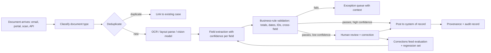

# Use Case — Document Intelligence Pipeline

**Status:** Proposed · **Primary RA:** [Inference](../reference-architectures/inference/README.md) + [Intelligent automation](../reference-architectures/intelligent-automation/README.md) · **Lifecycle:** [Data](../lifecycles/data-lifecycle.md), [RAG](../lifecycles/rag-lifecycle.md)

## Problem statement

Downstream processes (payments, claims, compliance, onboarding, maintenance) are blocked by unstructured documents — invoices, contracts, forms, emails, scans, reports — in inconsistent formats and variable quality. Manual keying is slow, error-prone, and does not scale, while downstream systems require structured, validated, reconciled data.

**Outcome wanted:** high-volume extraction of structured fields with confidence scores, automatic routing of low-confidence cases to humans, full provenance, and validation against business rules before data reaches systems of record.

## Pain points

| Pain | Consequence |
|---|---|
| Format variety and hand-written/scan variation | Brittle template-based extraction fails |
| Manual keying cost and errors | Slow cycle time, rework, disputes |
| Confidence unknown | All outputs treated equally; errors propagate silently |
| No provenance | Auditors can't trace a value to its source location |
| Validation happens after downstream writes | Corrections require compensating entries |
| Peak volume spikes | Backlogs; manual overtime |
| Multi-language/multi-currency documents | Extra manual handling |
| Duplicate documents | Double processing; conflicting records |

## Users & stakeholders

| Role | Interest |
|---|---|
| Operations/AP/claims teams | Throughput, low rework |
| Process owner | Cycle time and cost per document |
| Finance/audit | Accuracy, traceability, controls |
| Data engineering | Clean structured output downstream |
| Compliance | Retention, PII handling, audit trail |

## Workflow

**Human decision points:** low-confidence fields, validation failures, and disputes — with the source region highlighted for speed.

## Tech stack (layers, not products)

| Layer | Choice | Notes |
|---|---|---|
| Intake | Multi-channel with quarantine for unknown types | Prevent silent drops |
| Classification | Model-based type detection | Drives downstream extraction template |
| Parse/OCR | Layout-aware parsing + vision model for degraded scans | Preserve structure (tables) |
| Extraction | Schema-driven extraction with per-field confidence | Schema versioned as a contract |
| Validation | Business rules + cross-document reconciliation | Before the system of record |
| Review UI | Side-by-side source and fields, keyboard-first | Speed defines the ROI |
| Output contract | Typed, validated payload per document type | [Data contracts](../design-patterns/data-architecture.md) |
| Evaluation | Per-field accuracy on labeled set + adversarial/bad-scan set | [Evaluation lifecycle](../lifecycles/evaluation-lifecycle.md) |
| Provenance | Source coordinate/page per extracted field | Required for audit and review UX |

## Trade-offs

| Decision | Option A | Option B | Guidance |
|---|---|---|---|
| Extraction approach | Template/rule-based | Model-based (vision/LLM) | Model-based for variety; rules for fixed, high-volume formats |
| Confidence threshold | High (more human review) | Low (more automation, more errors) | Tune to cost-of-error; make it per-field, not per-document |
| Vision model vs OCR+text | End-to-end vision | OCR then text extraction | Vision handles layout/scans; OCR is cheaper for clean text |
| Human review granularity | Whole document | Per-field with confidence | Per-field; reviewers should fix only what's uncertain |
| Validation location | Downstream system | Pipeline (pre-write) | Pipeline; never pollute the system of record |
| Throughput vs cost | Large model per page | Cascade: cheap parse, escalate hard pages | Cascade with per-page escalation criteria |

## Success metrics

| Metric | Target direction |
|---|---|
| Per-field extraction accuracy | ↑ |
| Straight-through processing rate | ↑ |
| Cycle time per document | ↓ |
| Rework/correction rate | ↓ |
| Exception queue volume and age | ↓ |
| Duplicate processing | → 0 |
| Provenance completeness | 100% |
| Cost per document | Within envelope |

## Failure modes & mitigations

| Failure | Mitigation |
|---|---|
| Confident wrong extraction | Per-field confidence + rule validation + sampled audit |
| Poor scans degrade accuracy silently | Quality gate on image/layout before extraction; route bad scans early |
| New document format unhandled | Classification detects unknown type → quarantine + alert, not misclassification |
| Downstream rejections | Validate against the output contract before writing |
| Duplicate documents | Dedup on content hash + business keys |
| PII leakage into logs | Redaction at logging boundary ([controls](../security/ai-security-controls.md)) |
| Reviewer fatigue from over-routing | Threshold tuning with measured precision/recall of routing |

## Related artifacts

[Data architecture patterns](../design-patterns/data-architecture.md) · [Reliability patterns](../design-patterns/reliability-resilience.md) · [Intelligent automation RA](../reference-architectures/intelligent-automation/README.md) · [Production issues](../production-issues/retrieval-and-data.md)

## Future work

- Active learning on low-confidence fields to prioritize labeling
- Self-improving extractors from reviewer corrections (with bias safeguards)
- Multi-page document reasoning (contracts, claims packets)
- Cross-document reconciliation as a first-class capability
- Synthetic degraded-scan generation for robustness testing
