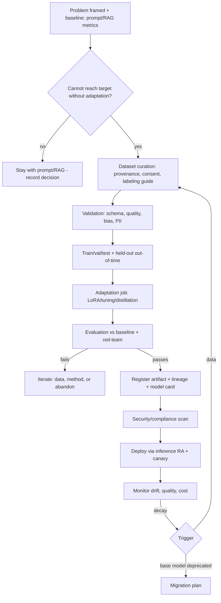

# Use Case — Domain Model Adaptation (Fine-tuning)

**Status:** Shipped · **Primary RA:** [Fine-tuning](../reference-architectures/fine-tuning/README.md) · **Lifecycle:** [ML project](../lifecycles/ml-project-lifecycle.md), [Model risk](../lifecycles/model-risk-lifecycle.md)

## Problem statement

A narrow, high-volume task uses specialized terminology, formats, or classification schemes (domain coding, structured extraction, tonal consistency) where a general model is inconsistent, expensive, or too slow. Prompting has plateaued, retrieval doesn't help because the need is behavior/format rather than knowledge, and per-call cost at volume is prohibitive.

**Outcome wanted:** a smaller or adapted model that hits the required quality on the narrow task at materially lower cost/latency — with evidence that it beats the prompting/RAG baseline.

## Pain points

| Pain | Consequence |
|---|---|
| General model inconsistent on domain terminology | Rework and low trust |
| Output format violations | Downstream parsing failures |
| Per-call cost at high volume | Budget pressure |
| Latency above SLA with large models | Poor user experience |
| Prompt changes regress other behaviors | Whack-a-meta maintenance |
| Labeled data scattered and undocumented | Cannot train responsibly |
| Fine-tuning treated as a silver bullet | Cost and maintenance with no measured gain |
| Base model deprecation after adaptation | Emergency migration |

## Users & stakeholders

| Role | Interest |
|---|---|
| Business owner | Quality on the specific task |
| ML engineer | Reproducible training, evaluation, deployment |
| Platform team | Serving cost/latency, registry, monitoring |
| Governance/risk | Lawful basis, fairness, interpretability, owner |
| Finance | Unit economics improvement |

## Workflow

**Human decision points:** go/no-go on adaptation; dataset lawful basis; approval before deployment (risk-tiered).

## Tech stack (layers, not products)

| Layer | Choice | Notes |
|---|---|---|
| Baseline first | Prompt + few-shot + RAG metrics | Required evidence before adapting |
| Dataset | Versioned, documented, consent-tracked | Data cards; bias review |
| Method | Parameter-efficient tuning → distillation for cost | Start cheap; measure |
| Evaluation | Held-out + out-of-time + adversarial + subgroup | Same rigor as [ML project lifecycle](../lifecycles/ml-project-lifecycle.md) |
| Registry | Immutable artifact + lineage + model card | [MLOps lifecycle](../lifecycles/mlops-lifecycle.md) |
| Serving | [Inference RA](../reference-architectures/inference/README.md) with canary | Compare against incumbent |
| Monitoring | Quality sampling, drift, cost, regression set | Retraining/deprecation triggers |

## Trade-offs

| Decision | Option A | Option B | Guidance |
|---|---|---|---|
| Adapt vs prompt/RAG | Fine-tune immediately | Exhaust prompting/RAG first | Adapt only with baseline evidence of a plateau |
| Method | Full fine-tune | LoRA/distillation | Parameter-efficient first; distill when cost is the constraint |
| Model size | Small adapted | Large general | Smaller adapted often wins on cost/latency at equal task quality |
| Data scope | Broad internal data | Narrow, curated, consented | Narrow and lawful; breadth rarely pays off |
| Hosting | Provider-hosted tuned model | Self-hosted weights | Hosted for speed; self-host when cost/control demands |
| Ownership | Team builds and forgets | Long-term maintenance funded | Fund maintenance — adapted models need owners |
| Governance | Treat as a feature | Treat as a model (risk tier) | Risk-tier it; high-impact uses need independent validation |

## Success metrics

| Metric | Target direction |
|---|---|
| Task quality vs baseline | ↑ beyond threshold |
| Cost per 1,000 inferences | ↓ |
| Latency p95 | ↓ |
| Format/parse failure rate | ↓ |
| Safety/quality regressions on held-out sets | → 0 |
| Maintenance cost (retrain cadence) | Understood and budgeted |
| Time to migrate on base-model deprecation | Planned, tested |

## Failure modes & mitigations

| Failure | Mitigation |
|---|---|
| Overfitting to a narrow training set | Held-out + out-of-time evaluation; subgroup analysis |
| Catastrophic forgetting of general behavior | Preserve-evaluation on base capabilities; LoRA as default |
| Training on data without lawful basis | Dataset gate before training begins |
| Silent quality regression after base deprecation | Pin versions; deprecation watch; migration test |
| Cost savings eaten by retraining toil | Automate CT; measure total cost of ownership |
| Poisoned or biased labels | Label QA, provenance, bias review |

## Related artifacts

[ML engineering patterns](../design-patterns/ml-engineering.md) · [Evaluation lifecycle](../lifecycles/evaluation-lifecycle.md) · [Model risk lifecycle](../lifecycles/model-risk-lifecycle.md) · [Production issues](../production-issues/platform-operations.md)

## Future work

- Automated baseline-vs-adaptation comparison harness
- Distillation pipelines tuned to quality-per-dollar targets
- Adapter/version management when multiple adaptations share a base model
- Fairness evaluation standardized across adapted models
- Provider-independent adapter portability