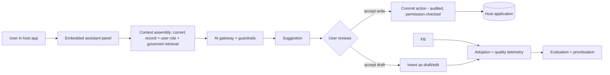

# Use Case — Enterprise Copilot Rollout

**Status:** Shipped · **Primary RA:** [Copilots](../reference-architectures/copilots/README.md) · **Lifecycle:** [Product](../lifecycles/product-lifecycle.md), [Enablement](../lifecycles/enablement-adoption-lifecycle.md)

## Problem statement

People work inside business applications (CRM, ERP, ITSM, productivity suites) and must leave them to use AI, losing context and creating copy-paste errors. Generic assistants lack record awareness, so output is generic and often wrong. Meanwhile, teams spin up ungoverned AI tools with production data because the approved path is slower than the unapproved one.

**Outcome wanted:** AI assistance where the work happens — aware of the current record and the user's permissions, suggesting rather than committing, measurable in adoption and time saved.

## Pain points

| Pain | Consequence |
|---|---|
| Context switching to external AI tools | Time lost; errors from manual re-entry |
| Generic output ignoring the current record | Low trust; users stop using it |
| Shadow AI tools with production data | Ungoverned data handling; compliance exposure |
| Vendors shipping incompatible embedded AI | Fragmented experience; duplicated spend |
| Uncertainty about what the AI can see | Trust and compliance concerns |
| Write actions with no review | Risk of unintended record changes |
| No adoption measurement | Spend with no evidence of value |
| Host-app upgrades breaking integrations | Silent capability loss |

## Users & stakeholders

| Role | Interest |
|---|---|
| Front-line user | Faster task completion in place |
| Functional owner | Consistency and quality of outputs |
| IT/application owner | Upgrade compatibility; integration health |
| Security/privacy | Data boundaries; write-scope control |
| Platform team | Reuse of gateway/eval/guardrails rather than per-app builds |
| Finance | Measured value per seat/license |

## Workflow

**Human decision points:** every write is user-initiated; high-impact actions use the [HITL pattern](../design-patterns/human-in-the-loop-approval.md).

## Tech stack (layers, not products)

| Layer | Choice | Notes |
|---|---|---|
| Embedding surface | Native host-app extension points | Configuration-first where possible |
| Context assembly | Record context + governed retrieval + permission filtering | Minimization: send only what the task needs |
| Access | Gateway-mediated model calls | No per-app provider keys |
| Write path | Explicit, permission-scoped, audited API calls | Separate read and write scopes |
| Telemetry | Adoption, acceptance, edit-before-accept, task time | Feature-versioned |
| Rollout | Feature flags per org unit; kill switch | [Experimentation lifecycle](../lifecycles/experimentation-lifecycle.md) |
| Compatibility | Contract tests against host-app versions | Upgrade test matrix |

## Trade-offs

| Decision | Option A | Option B | Guidance |
|---|---|---|---|
| Build vs embed | Build a standalone AI app | Embed in existing apps | Embed where the work happens; standalone only for cross-app tasks |
| Generic vs record-aware | Generic assistant | Record + retrieval aware | Record-aware; generic underperforms enough to kill adoption |
| Read vs write | Read-only assistance | Write actions | Read first, measure, then add writes with review |
| Vendor embedded AI vs own | Vendor feature | Own build on the platform | Use vendor where it's good; own the context/permission/telemetry layer |
| Permissions | Broad copilot access | User-inherited permissions | Always user-inherited, never a superuser copilot |
| Rollout | Company-wide toggle | Phased by unit/role | Phased with adoption data per cohort |

## Success metrics

| Metric | Target direction |
|---|---|
| Weekly active usage per licensed cohort | ↑ |
| Acceptance rate (suggestions accepted) | ↑ |
| Task completion time vs baseline | ↓ |
| Edit-before-accept rate | Improves (suggestion quality) |
| User-reported trust | ↑ |
| Write-action error rate | → 0 |
| Data-handling exceptions | → 0 |
| Cost per active user | Within envelope |

## Failure modes & mitigations

| Failure | Mitigation |
|---|---|
| Low adoption despite deployment | Measure acceptance and time-to-task; fix quality before expanding |
| Cross-user or cross-record context leak | User-scoped context, per-record permission checks |
| Unreviewed writes into systems of record | Draft-first, explicit commit, audit trail |
| Host-app upgrade breaks the assistant | Contract tests + compatibility matrix in CI |
| Shadow tools persist | Make the approved path faster and visibly safer |
| Vendor-embedded AI conflicts with policy | Gateway-mediated access for all AI paths |

## Related artifacts

[Copilots RA](../reference-architectures/copilots/README.md) · [AI UX patterns](../design-patterns/ai-ux-and-interaction.md) · [Integration patterns](../standards/integration-patterns.md) · [Production issues](../production-issues/security-and-injection.md)

## Future work

- Cross-application context with explicit user consent and audit
- Adaptive suggestion placement learned from acceptance patterns
- Privacy-preserving personalization without record data leaving the boundary
- Shared evaluation sets across similar copilots to avoid duplicated effort
- Automated compatibility testing against host-app release candidates