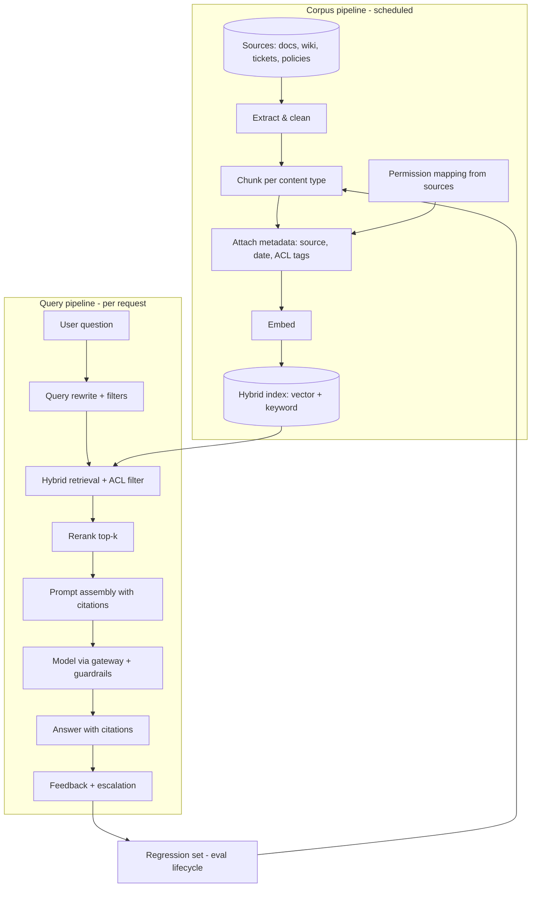

# Use Case — Enterprise Knowledge Assistant

**Status:** Proposed · **Primary RA:** [RAG](../reference-architectures/rag/README.md) · **Lifecycle:** [RAG](../lifecycles/rag-lifecycle.md), [GenAI/LLMOps](../lifecycles/genai-llmops-lifecycle.md)

## Problem statement

Employees cannot find authoritative answers because knowledge is scattered across document stores, wikis, tickets, and email, each with different permissions and freshness. The result is duplicated questions to experts, inconsistent answers, slow onboarding, and decisions made on stale information. Keyword search returns documents, not answers, and does not respect access boundaries.

**Outcome wanted:** ask a question in natural language, get a grounded answer with citations, scoped to what the asker is permitted to see, available in seconds.

## Pain points

| Pain | Consequence |
|---|---|
| Knowledge fragmented across many systems | No single place to ask; experts become human search engines |
| Search returns documents, not answers | High cognitive load; users give up or guess |
| Documents go stale silently | Confident answers based on superseded policy |
| Permission models differ per source | Retrofit ACLs are wrong or over-restrictive |
| No feedback loop from "answer was wrong" | Same failure repeats forever |
| Long documents, no structure | Naive chunking destroys context and tables |
| Multi-language content | Retrieval and answer quality drop for non-primary languages |
| No measurement of answer quality | Improvements are anecdotal |

## Users & stakeholders

| Role | Interest |
|---|---|
| Knowledge worker / support agent | Fast, correct, cited answers |
| Subject-matter expert | Fewer interruptions; ability to correct the record |
| Knowledge/content owner | Source freshness and ownership |
| Security & compliance | Access boundaries, retention, auditability |
| Platform engineering | Cost, reliability, and adoption signal |

## Workflow

**Human decision points:** escalation to an expert when confidence is low or the question is out of scope; content owners correct stale sources (not the index).

## Tech stack (layers, not products)

| Layer | Choice | Notes |
|---|---|---|
| Ingestion | Scheduled + incremental, idempotent | Per-type extractors (prose, tables, slides, code) |
| Storage | Object store + document database + metadata store | Provenance and ACL tags mandatory |
| Index | Hybrid (vector + keyword) with metadata filters | Dense-only misses identifiers; sparse-only misses paraphrases |
| Embeddings | Versioned embedding model, re-embed as migration | See [RAG lifecycle change matrix](../lifecycles/rag-lifecycle.md) |
| Reranking | Cross-encoder or model-based reranker | Biggest quality lever after hybrid search |
| Serving | AI gateway → guardrails → model | See [inference RA](../reference-architectures/inference/README.md) |
| Evaluation | Golden Q→docs→answer set + adversarial set in CI | [Evaluation in CI](../design-patterns/evaluation-in-ci.md) |
| Observability | Traces (retrieval + generation), quality sampling, cost per query | Stage-decomposed |

## Trade-offs

| Decision | Option A | Option B | Guidance |
|---|---|---|---|
| Chunk size | Small (precise, fragmented) | Large (context, diluted) | Parent-document or sentence-window often beats both ends |
| Retrieval | Dense only | Hybrid + rerank | Hybrid + rerank default; measure before adding |
| Freshness | Real-time indexing | Batch refresh | Match source change rate; most corpora don't need real-time |
| ACL enforcement | Pre-filter at retrieval | Post-filter results | Pre-filter only — post-filtering leaks existence and count |
| Answer posture | Always attempt an answer | Refuse without evidence | Refuse/qualify; over-answering destroys trust fastest |
| Scope | Everything indexed | Curated corpora | Start narrow, high-value, high-quality sources |
| Model | Largest available | Cascade (small default) | Cascade with evaluation; escalate on low confidence |
| Citations | Inline per claim | Appendix list | Inline per claim; users verify the specific sentence |

## Success metrics

| Metric | Layer | Target direction |
|---|---|---|
| Retrieval hit-rate / recall@k | Retrieval | ↑ |
| Faithfulness, citation correctness | Generation | ↑ |
| Answer acceptance / thumbs-up | User | ↑ |
| Escalation rate (appropriate) | System | Stable, low |
| Time-to-answer | System | ↓ |
| Expert interruptions for routine questions | Business | ↓ |
| Cost per answered question | FinOps | Within envelope |
| Stale-source incidents | Data | → 0 |

## Failure modes & mitigations

| Failure | Mitigation |
|---|---|
| Confident answer from stale document | Freshness SLO + "last updated" surfacing + source-owner alerts |
| Permission leak | Retrieval-time ACLs + negative tests for unauthorized chunks |
| Injection via indexed content | Untrusted-content handling + input screening ([controls](../security/ai-security-controls.md)) |
| Empty results for ordinary questions | Fallback broad retrieval + query rewriting |
| Tables/PDFs mangled by chunking | Per-type extractors and chunking specs |
| Same wrong answer repeatedly | Feedback → regression set → re-eval |

## Related artifacts

[RAG patterns](../design-patterns/rag-patterns.md) · [Semantic layer](../design-patterns/semantic-layer-grounding.md) (for metric-backed answers) · [Prompt lifecycle](../lifecycles/prompt-lifecycle.md) · [Production issues](../production-issues/retrieval-and-data.md)

## Future work

- Graph retrieval for relationship-heavy questions (with evaluation showing a real gain)
- Confidence-calibrated abstention thresholds per domain
- Cross-language retrieval parity evaluation
- Automatic stale-content detection from source change signals
- Adaptive retrieval (skip retrieval for purely conversational turns)
