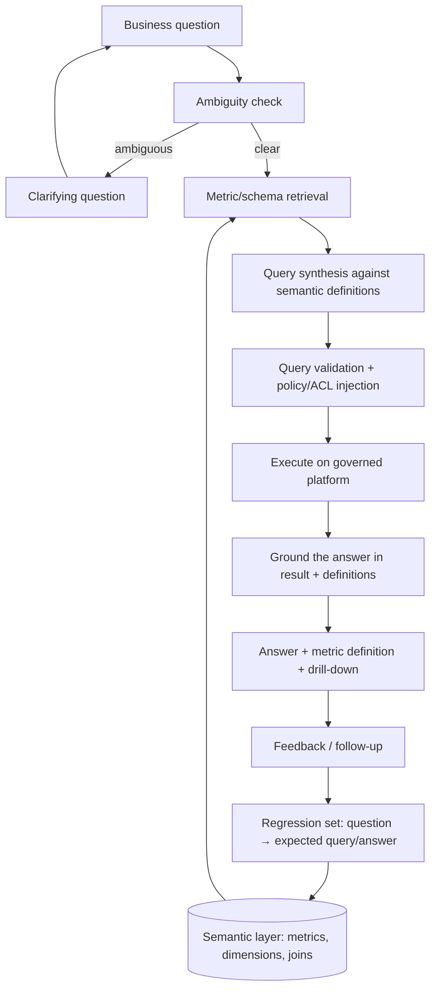

# Use Case — Natural-Language Analytics (Data Agent)

**Status:** Proposed · **Primary RA:** [Data agent](../reference-architectures/data-agent/README.md) · **Lifecycle:** [Data](../lifecycles/data-lifecycle.md), [Evaluation](../lifecycles/evaluation-lifecycle.md)

## Problem statement

Business users depend on analysts for routine data questions. The analyst queue is saturated with repetitive requests, answers take days, and every analyst computes the same metric slightly differently, so numbers disagree across reports. Users who attempt self-service SQL on raw tables produce inconsistently defined metrics and lose trust in the data.

**Outcome wanted:** ask a business question in plain language and get a query result **based on governed metric definitions**, with the definition shown, permissions respected, and the ability to drill down.

## Pain points

| Pain | Consequence |
|---|---|
| Analyst bottleneck for routine questions | Days of latency; analysts doing low-value work |
| Metric definitions differ per report/team | Conflicting numbers; eroded trust |
| Raw-table access for self-service | Inconsistent joins; silently wrong answers |
| Users don't know what data exists | Questions never asked; wasted assets |
| Permissions live in the warehouse | NL interfaces bypass them if implemented naively |
| Ambiguous business questions | Wrong query answered confidently |
| Results without explanation | Users can't verify or act |
| No feedback on wrong answers | Same misinterpretation repeats |

## Users & stakeholders

| Role | Interest |
|---|---|
| Business user / manager | Fast, trustworthy answers without SQL |
| Analyst | Offload routine work; focus on deep analysis |
| Data governance | One definition of business meaning |
| Data engineering | Semantic layer modeled once, reused by BI and AI |
| Security | Row/column policies enforced identically |

## Workflow

**Human decision points:** ambiguity clarification; governance approval of new metric definitions; escalation to an analyst for novel analysis.

## Tech stack (layers, not products)

| Layer | Choice | Notes |
|---|---|---|
| Semantic layer | Governed metrics/dimensions/joins, versioned as code | The architectural keystone ([pattern](../design-patterns/semantic-layer-grounding.md)) |
| Metadata retrieval | Vector + keyword index over semantic catalog, table/column docs | Small corpus, high precision |
| Query synthesis | Model → query against semantic layer or guarded SQL | Validate before executing |
| Policy | Row/column security + masking from the platform, applied per user identity | No agent superuser |
| Execution | Governed data platform with query cost controls | Kill runaway queries |
| Evaluation | Golden set of question → expected result pairs per domain | Two layers: query correctness + answer correctness |
| Observability | Query audit log, cost/scan metrics, clarification rate, correction rate | Feeds metric grooming |

## Trade-offs

| Decision | Option A | Option B | Guidance |
|---|---|---|---|
| Query target | Semantic layer | Raw SQL | Semantic layer first; raw only for advanced users with guardrails |
| Ambiguity | Best-effort guess | Ask clarifying question | Ask when confidence is low; guessing confidently is the worse failure |
| Metric additions | Central governance only | Domain self-service with review | Federated with review; central-only becomes a bottleneck |
| Latency | Pre-computed/cached metrics | Live queries | Cache common metrics; live for drill-down |
| Explanations | Answer only | Answer + definition + data lineage | Include definition; verification drives trust |
| Access scope | Broad (convenience) | Strict per role | Strict; convenience here is a compliance incident |
| Handling of "no metric exists" | Improvise a calculation | Say it isn't defined yet | Say so, and route to governance for definition |

## Success metrics

| Metric | Target direction |
|---|---|
| Query correctness vs golden set | ↑ |
| Answer correctness | ↑ |
| Analysts' routine-request load | ↓ |
| Time-to-answer | ↓ |
| Clarification rate (healthy, not excessive) | Stable |
| Metric definitions reused across BI + AI | ↑ |
| Unauthorized-access attempts (should be denied) | → 0 succeeded |
| Cost per query / scan volume | Within envelope |

## Failure modes & mitigations

| Failure | Mitigation |
|---|---|
| Confident wrong answer from misread question | Ambiguity detection + clarification + query validation |
| Silent metric inconsistency | Semantic layer as the only source of definitions |
| Row-level security bypass | Identity propagation + policy injection + negative tests |
| Runaway query cost | Cost ceilings, scan limits, query timeouts |
| Undefined metric improvised | Explicit "not defined" path routed to governance |
| Semantic layer change breaks answers | Definition change triggers evaluation re-run |
| Users trust a single number without context | Always show definition, filters, and time window |

## Related artifacts

[Data lifecycle](../lifecycles/data-lifecycle.md) · [Data architecture patterns](../design-patterns/data-architecture.md) · [Evaluation lifecycle](../lifecycles/evaluation-lifecycle.md) · [Production issues](../production-issues/retrieval-and-data.md)

## Future work

- Automated metric onboarding from BI report discovery
- Anomaly-aware answers ("this is 3σ above the 12-week norm")
- Multi-step analysis (cohort → segmentation) with human-approved query plans
- Definition-drift detection across legacy reports still in circulation
- Self-serve metric authoring with governance review workflow
