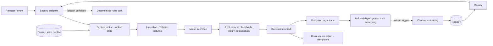

# Use Case — Real-Time Decision Scoring

**Status:** Proposed · **Primary RA:** [Inference](../reference-architectures/inference/README.md) · **Lifecycle:** [ML project](../lifecycles/ml-project-lifecycle.md), [MLOps](../lifecycles/mlops-lifecycle.md), [Operations](../lifecycles/operations-incident-lifecycle.md)

## Problem statement

A high-volume decision (fraud check, eligibility, prioritization, dynamic routing, risk pricing) must be made in milliseconds, thousands of times per second, with no tolerance for silent failure. The current rules-only system either misses cases it should catch or flags too many, and adding a model requires serving, monitoring, and rollback capability the team doesn't have today.

**Outcome wanted:** low-latency, high-availability scoring with features served consistently between training and production, safe rollout, and automatic degradation when the model or a dependency fails.

## Pain points

| Pain | Consequence |
|---|---|
| Rules can't capture patterns in the data | Missed fraud/risk; poor segmentation |
| Feature logic duplicated in training and serving | Train/serve skew; unexplained production quality drop |
| No latency budget ownership | p99 violations under peak |
| No model-quality monitoring | Degradation noticed by business, not engineering |
| Rollout fear | New models never shipped |
| No safe fallback | Model outage = business outage |
| Drift silently reduces effectiveness | Value erosion over months |
| Race conditions and retries duplicate side effects | Double actions, reconciliation burden |

## Users & stakeholders

| Role | Interest |
|---|---|
| Business/operations | Decision quality, service continuity |
| ML engineer | Reproducible training, low-drift serving |
| Platform/SRE | Latency SLOs, capacity, graceful degradation |
| Risk/compliance | Explainability, audit, fairness, reversibility |
| Finance | Cost per decision |

## Workflow

**Human decision points:** threshold policy changes, model promotion approval (risk-tiered), and incident response.

## Tech stack (layers, not products)

| Layer | Choice | Notes |
|---|---|---|
| Feature serving | Online feature store; point-in-time correct offline reads | Single transformation definition ([ML engineering](../design-patterns/ml-engineering.md)) |
| Serving | Autoscaled endpoints; warm capacity per SLO | Scale on queue depth/latency |
| Orchestration | Event-driven with idempotency keys | Safe retries |
| Decisioning | Thresholds + policy layer outside the model | Deterministic and auditable |
| Monitoring | Latency, drift, delayed ground truth, quality SLO | Quality as a first-class SLO |
| Rollout | Shadow → canary → champion/challenger | Pre-registered criteria |
| CT | Drift/perf-triggered retraining with gates | Bounded auto-promotion |

## Trade-offs

| Decision | Option A | Option B | Guidance |
|---|---|---|---|
| Model complexity | Simple, explainable | Complex, marginal gains | Explainability matters for regulated decisions; prefer the simplest model that clears the bar |
| Latency vs accuracy | Fast/small | Slow/strong | Decompose the latency budget; use cascade if accuracy needs are uneven |
| Features | Many, fresh | Few, cached | Freshness has a latency cost; measure marginal accuracy |
| Threshold | Optimize accuracy | Optimize cost asymmetry | Use the business cost of false positives vs false negatives |
| Fallback | Fail the request | Rules fallback | Degrade to rules; never a hard failure for critical decisions |
| Auto-retrain | Manual only | Automatic with guardrails | Bounded automatic promotion with rollback for medium tier; manual for high |
| Explanation | Post-hoc only | Native/interpretable model | Regulated contexts may require native interpretability |

## Success metrics

| Metric | Target |
|---|---|
| p95/p99 latency | Within budget at peak |
| Availability | ≥ tier SLO |
| Decision quality (precision/recall, cost-weighted) | Meets threshold |
| Train/serve skew incidence | → 0 |
| Drift detection → response time | Bounded |
| Fallback activation correctness | 100% in drills |
| Idempotency violations | → 0 |
| Cost per decision | Within envelope |

## Failure modes & mitigations

| Failure | Mitigation |
|---|---|
| Features missing/slow at inference | Timeout + cached/stale feature policy + fallback path |
| Silent quality decay | Delayed ground-truth monitoring + quality SLO + CT triggers |
| Retry storm amplifying load | Backoff + jitter + idempotency + load shedding |
| Duplicate side effects | Idempotency keys on downstream actions |
| Region/zone loss | Multi-zone deployment, cell isolation |
| Model promotion regression | Shadow/canary with pre-registered criteria + instant rollback |
| Unfair outcomes across segments | Subgroup evaluation + fairness monitoring for risk-tiered use |

## Related artifacts

[MLOps deployment patterns](../design-patterns/mlops-deployment.md) · [Reliability patterns](../design-patterns/reliability-resilience.md) · [Distributed scaling](../design-patterns/distributed-scaling.md) · [Production issues](../production-issues/platform-operations.md)

## Future work

- Automated drift-response policies with bounded autonomy
- Online learning where feedback latency allows, with strict guardrails
- Feature-quality SLOs alongside model-quality SLOs
- Counterfactual and off-policy evaluation for policy-heavy decisions
- Standardized fairness dashboards across risk-tiered models
